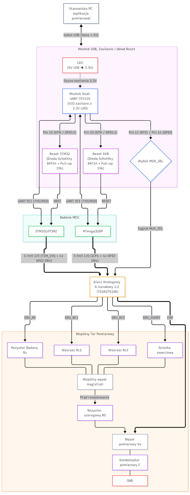
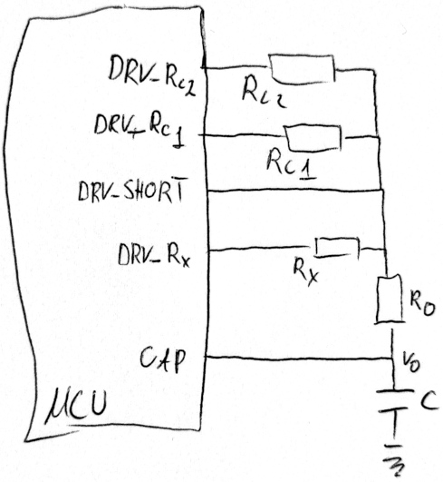

# Dokumentacja Koncepcyjna Projektu

**Temat pracy:** *Implementacja bezpośredniego interfejsu sensor-mikrokontroler dla czujników rezystancyjnych.*

## 1. Cel i Założenia Projektu

- **Główny cel:** Zbudowanie autorskiego stanowiska pomiarowego do przeprowadzenia metrologicznego porównania trzech metod kalibracji układów DIC (1-, 2- i 3-punktowej).

## 2. Metodologia i Metody Kalibracji (RC-DIC)

Pomiar w układzie DIC polega na wyznaczeniu czasu rozładowania kondensatora $C$ przez badany tor rezystancyjny do dolnego progu bufora Schmitta / komparatora $V_{TL}$. Zmierzony czas $T_d$ reprezentowany jest liczbą cykli zegara referencyjnego $N$.

| Metoda Kalibracji | Wymagane Elementy Wzorcowe | Wzór Przeliczeniowy | Eliminowane Błędy i Właściwości |
| :--- | :--- | :--- | :--- |
| **Jednopunktowa** | 1 rezystor wzorcowy $R_{c2}$ | $R_x = \frac{N_x}{N_{c2}} R_{c2}$ | Eliminuje zmiany pojemności $C$, napięcia zasilania $V_{CC}$, dryft zegara $T_{ref}$ oraz tolerancję progu $V_{TL}$. Zakłada idealny brak offsetu czasowego i rezystancji pasożytniczych (wymaga pominięcia $R_0$). |
| **Dwupunktowa** | 2 rezystory wzorcowe $R_{c1}, R_{c2}$ | $R_x = R_{c1} + \frac{N_x - N_{c1}}{N_{c2} - N_{c1}}(R_{c2} - R_{c1})$ | Kompensuje stały błąd zerowy (offset czasowy, opóźnienia buforów) oraz liniową część rezystancji wyjściowej pinów $R_{OL}$. |
| **Trzypunktowa** | Rezystor $R_{c2}$ + Zwarcie ($0\ \Omega$) + Rezystor wspólny $R_0$ | $R_x = \frac{N_x - N_0}{N_{c2} - N_0} R_{c2}$ | Eliminuje wszystkie powyższe + rezystancję wyjściową tranzystorów GPIO ($R_{OL}$), opóźnienie programowe i wprowadzoną rezystancję $R_0$. Pozwala uzyskać błąd względny $< 0.01\%$. |

> **Wniosek:** Układ do kalibracji 3-punktowej jest nadzbiorem pozostałych metod. Przełączając piny w kodzie programowym, na jednym fizycznym torze pomiarowym realizowane są wszystkie trzy algorytmy.

## 3. Architektura Sprzętowa

### 3.1. Diagram blokowy

### 3.2. Tor Pomiarowy (5 Linii)

Tor pomiarowy składa się z 5 fizycznych linii podłączonych do mikrokontrolera oraz wspólnego węzła z rezystorem ograniczającym $R_0$ i kondensatorem $C$:

1. **Linia `CAP`:** Podłączona bezpośrednio do węzła pomiarowego $V_o$ (okładka kondensatora $C$) oraz wejścia zatrzaskującego Timer 1 (`ICP1` / `PB0`) lub wejścia komparatora analogowego (`AIN1`).
2. **Linia `DRV_RX`:** Dołączona do gniazda badanego czujnika/rezystora $R_x$.
3. **Linia `DRV_RC1`:** Dołączona do dolnego rezystora wzorcowego $R_{c1}$.
4. **Linia `DRV_RC2`:** Dołączona do górnego rezystora wzorcowego $R_{c2}$.
5. **Linia `DRV_SHORT`:** Dołączona do ścieżki zwarciowej ($0\ \Omega$), służącej do wyznaczenia punktu zerowego ($N_0$) oraz do szybkiego ładowania kondensatora.

#### Elementy bierne i konfiguracja toru

- **Rezystor $R_0$ w gałęzi wspólnej:** Umieszczony szeregowo pomiędzy węzłem sumacyjnym linii sterujących (`DRV_RX`, `DRV_RC1`, `DRV_RC2`, `DRV_SHORT`) a węzłem $V_o$ kondensatora $C$. Ogranicza prąd szczytowy pinu zwarciowego do bezpiecznej wartości liniowej pracy tranzystorów ($I_{peak} < 5\text{ mA}$) i jest w pełni kompensowany w metodzie 3-punktowej.
- **Zworka sprzętowa:** Umieszczona równolegle do $R_0$. Umożliwia sprzętowe zwarcie rezystora $R_0$ podczas badań metody 1-punktowej, co zapobiega fałszowaniu jej wyników przez sztuczny offset.
- **Kondensator $C$:** Kondensator ceramiczny klasy 1 (dielektryk C0G/NP0) lub foliowy FKP/MKP (np. $10\text{–}100\text{ nF}$) charakteryzujący się pomijalną absorpcją dielektryczną i niskim współczynnikiem temperaturowym.
- **Gniazda testowe:** Złocone gniazda kołkowe (Machined Pins THT) umożliwiające szybką wymianę elementów $R_x, C, R_{c1}, R_{c2}, R_0$ oraz podłączenie laboratoryjnej dekady rezystancyjnej.

### 3.3. Mikrokontroler i Taktowanie

- **Mikrokontroler:** ATmega328P-PU w podstawce DIP-28.
- **Taktowanie:**
  - Zewnętrzny rezonator kwarcowy $16.000\text{ MHz}$ o stabilności $\le 50\text{ ppm}$ ($T_{ref} = 62.5\text{ ns}$ przy preskalerze 1).
  - Dwa kondensatory obciążające $22\text{ pF}$ C0G/NP0 umieszczone bezpośrednio przy wyprowadzeniach `XTAL1` i `XTAL2`.
- **Odsprzęganie i filtracja:**
  - Kondensatory ceramiczne $100\text{ nF}$ bezpośrednio przy parach zasilania $V_{CC}$/GND.
  - Filtr dolnoprzepustowy LC/RC na gałęzi analogowej $AV_{CC}$ oraz kondensator $100\text{ nF}$ na pinie `AREF`.
  - Rozdzielenie masy cyfrowej układu od masy analogowej (dolna okładka kondensatora $C$).
- **Pomiar czas:** 16-bitowy Timer 1 ze sprzętowym wejściem *Input Capture* (`ICP1` / `PB0`) lub opcjonalnie z wewnętrznym komparatorem analogowym (`ACSR.ACIC`).

### 3.4. Zasilanie i Komunikacja USB-C

- **Złącze USB-C:** Odpowiada za zasilanie układu napięciem $5\text{ V}$ ($V_{BUS}$) oraz transmisję danych pomiarowych do PC.
- **Konfiguracja linii CC:** Wyprowadzenia `CC1` i `CC2` gniazda USB-C wyposażone w niezależne rezystory pull-down $5.1\text{ k}\Omega$ do masy (tryb UFP/Sink), co zapewnia poprawne załączenie zasilania przy połączeniach kablem typu C-do-C.
- **Filtracja zasilania USB:** Dławik ferrytowy w szeregu z $V_{BUS}$, kondensator tantalowy $10\ \mu\text{F}$ oraz ceramiczne $100\text{ nF}$ filtrujące zakłócenia w.cz. z przetwornic komputera PC.
- **Mostek USB $\leftrightarrow$ UART:** Układ konwertera (np. `MCP2221A`). Linie `TXD` i `RXD` połączone z pinami `PD0` i `PD1` mikrokontrolera.
- **Reset:** Linia $\overline{\text{RESET}}$ podciągnięta rezystorem $10\text{ k}\Omega$ do $+5\text{ V}$, zabezpieczona kondensatorem oraz połączona z przyciskiem monostabilnym do masy.

### 3.4. Interfejs Programowania ISP

- **Złącze AVR ISP (Kanda 2×3, raster 2.54 mm):**
  - Wyprowadza linie: `MOSI` (`PB3`), `MISO` (`PB4`), `SCK` (`PB5`), $\overline{\text{RESET}}$, $V_{CC}$ oraz `GND`.
  - Służy do programowania pamięci Flash oraz konfiguracji bitów fusebit (wybór zewnętrznego kwarcu 16 MHz, wyłączenie podziału zegara `CKDIV8`) za pomocą programatora USBasp.

## 4. Firmware i Sekwencja Pomiarowa

W celu zachowania powtarzalności, każdy cykl pomiarowy rozpoczyna się od naładowania kondensatora tą samą ścieżką.

### 4.1. Sekwencja pojedynczego pomiaru (dla wybranego kanału)

1. **Inicjalizacja:**
   - Wszystkie linie sterujące (`DRV_RX`, `DRV_RC1`, `DRV_RC2`, `DRV_SHORT`) ustawione w tryb wysokiej impedancji *High-Z*.
   - Linia `CAP` skonfigurowana jako wejście bez podciągania.
   - Timer 1 wyzerowany, skonfigurowany do pracy z preskalerem 1 i wyzwalaniem zboczem opadającym na module *Input Capture*.
2. **Ładowanie kondensatora (identyczne dla każdego kanału):**
   - Linia `DRV_SHORT` przełączana w tryb wyjścia w stanie wysokim ($5\text{ V}$).
   - Kondensator $C$ ładuje się przez rezystor $R_0$ przez stały czas $T_c \ge 5 R_0 C$ gwarantujący pełne osiągnięcie napięcia szyny $V_{CC}$.
   - Linia `DRV_SHORT` zostaje przełączona z powrotem w stan *High-Z*.
3. **Rozładowanie i pomiar czasu:**
   - Wybrana linia sterująca badanego kanału (np. `DRV_RX` dla czujnika, `DRV_RC1`, `DRV_RC2` lub `DRV_SHORT` dla zwarcia) zostaje przełączona w tryb wyjścia w stanie niskim ($0\text{ V}$).
   - Timer 1 rozpoczyna zliczanie taktów zegara $16\text{ MHz}$.
   - Mikrokontroler przechodzi natychmiast w tryb obniżonego poboru mocy **Idle Mode** (wyłączenie zegara CPU, zatrzymanie szumów cyfrowych rdzenia).
   - Gdy napięcie $V_o$ spadnie do progu $V_{TL}$, moduł *Input Capture* sprzętowo zatrzaskuje stan licznika do rejestru `ICR1` i generuje przerwanie budzące CPU.
   - Odczytana wartość rejestru zatrzaskowego trafia do zmiennej pomiarowej. Aktywny pin sterujący wraca do stanu *High-Z*.
   - Obsługa wektora `TIMER1_OVF_vect` zabezpiecza pomiar przed przepełnieniem licznika przy dużych stałych czasowych.

### 4.2. Przetwarzanie danych pomiarowych

Surowe dane pomiarowe (zliczone cykle zegara) są przesyłane przez USB do PC. Skrypt pomiarowy na ich podstawie oblicza rezystancję $R_x$ oraz wyznacza odpowiednie wskaźniki świadczące o jakości pomiaru.
